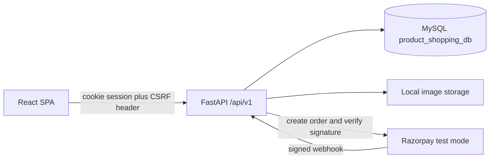
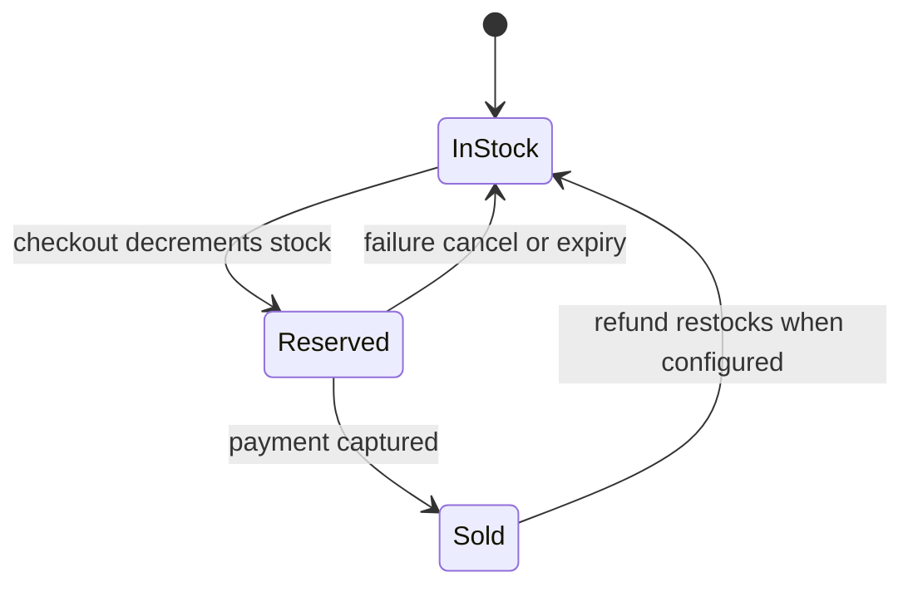
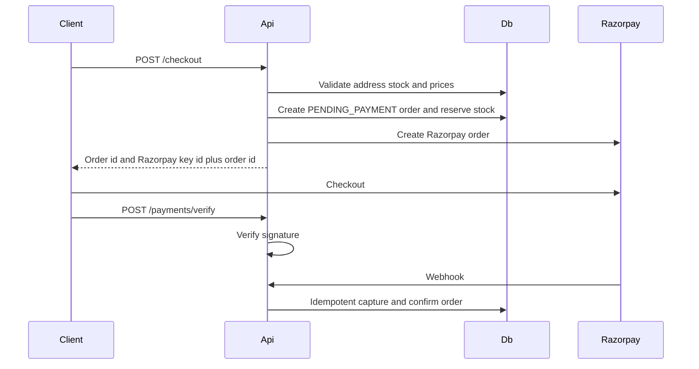

# Architecture

## Goal

Ritz is a single-shop e-commerce application. Customers browse products, manage a cart, check out, pay with Razorpay, and view orders and invoices. Administrators manage catalog, inventory, customers, orders, payments, coupons, and reviews.

## System context



The browser never receives the Razorpay key secret or webhook secret. It receives the public key id and the Razorpay order id needed to open Checkout.

## Repository layout

```text
ritz_Ecommerce/
├── frontend/
│   ├── src/
│   │   ├── components/
│   │   ├── pages/
│   │   ├── layouts/
│   │   ├── hooks/
│   │   ├── services/
│   │   ├── types/
│   │   ├── utils/
│   │   └── routes/
│   ├── public/
│   ├── package.json
│   └── vite.config.ts
├── backend/
│   ├── app/
│   │   ├── api/v1/
│   │   ├── core/
│   │   ├── db/
│   │   ├── models/
│   │   ├── schemas/
│   │   ├── repositories/
│   │   ├── services/
│   │   ├── middleware/
│   │   ├── utils/
│   │   └── main.py
│   ├── alembic/
│   ├── tests/
│   ├── uploads/
│   ├── requirements.txt
│   ├── alembic.ini
│   └── .env.example
├── database/
├── docs/
└── documentation at the repository root
```

`backend/uploads/` is local development storage. It is not committed.

## Backend layers

| Layer | Responsibility |
| --- | --- |
| `api/v1` | HTTP routes, status codes, dependency injection |
| `schemas` | Pydantic request and response models |
| `middleware` | Request logging, rate limits on login and other sensitive routes |
| `services` | Transactions, pricing, stock, coupons, payments, authorization rules that span entities |
| `repositories` | SQLAlchemy queries and persistence |
| `models` | SQLAlchemy 2.x mapped classes |
| `db` | Engine, session factory, transaction helpers |
| `core` | Settings, security helpers, logging configuration |

Routers stay thin. They validate input through Pydantic, resolve the current user, and call a service. Services own commit and rollback. Repositories do not decide prices, roles, or payment success.

FastAPI’s generated OpenAPI UI is served at `/docs`. All application routes use the prefix `/api/v1`.

## Request lifecycle

1. CORS allows the configured frontend origin and credentials.
2. A logging middleware records method, path, and status. It does not record passwords, tokens, card data, or payment secrets.
3. Protected routes require a valid access-token cookie.
4. Mutating routes also require a matching CSRF header.
5. Admin routes require the `ADMIN` role.
6. Unexpected errors become HTTP 500 responses without a stack trace. Validation errors stay on HTTP 422.

## Authentication and authorization

| Piece | Behavior |
| --- | --- |
| Password storage | Argon2 hash via pwdlib. Plaintext passwords are never stored or logged. |
| Access token | Short-lived JWT in an `httpOnly` cookie. Default lifetime is 30 minutes. |
| Refresh | Refresh token in a separate `httpOnly` cookie, rotated on use. |
| CSRF | Readable CSRF cookie; unsafe methods must echo it in a header. |
| Logout | Server clears the auth cookies. |
| Roles | `CUSTOMER` and `ADMIN`, stored in a `roles` table. |
| Registration | Creates an active customer only. |
| First admin | Seed command reads `ADMIN_EMAIL` and `ADMIN_PASSWORD` from the environment. |

Customers can read and change only their own profile, addresses, cart, wishlist, reviews, and orders. Hiding an admin link in the UI is not authorization. Every admin and ownership check runs in the backend.

Development uses a Vite proxy so the SPA and API share an origin and `SameSite=Lax` cookies work. Production sets `Secure` on cookies and restricts CORS to `FRONTEND_URL`.

## Catalog

Public product and category reads return active records only. Administrators can list and edit inactive records.

Customers can search text, filter by category, brand, price range, and availability, sort, and page through results. Filtering and pagination run in MySQL, not in the browser.

Each product may have multiple images. The primary image is the one flagged `is_primary`. Files are written under `backend/uploads/` after content-type and size checks. The database stores the public URL, alt text, and sort order.

## Pricing

The checkout service loads current product rows and computes:

- Unit selling price from the stored price and discount
- Line tax from the product tax rate, or the configured default GST rate when the product rate is null
- Subtotal, discount, tax, and delivery fee
- Coupon discount when the code is active, in its date window, under its usage limit, and the order meets the minimum amount
- Grand total

Delivery is a flat fee from configuration. It is waived when the merchandise subtotal meets the free-delivery threshold.

Order items persist the product name, SKU, unit price, discount, tax rate, tax amount, quantity, and line total. Later catalog edits do not change issued invoices.

Currency is INR. Values are `Decimal`, never binary floating point. The Razorpay order amount is the grand total converted to paise with half-up rounding to the nearest paisa.

## Stock reservation



Checkout locks the involved product rows and updates stock only when `stock_quantity` is at least the requested quantity. The order is stored as `PENDING_PAYMENT` with `reservation_expires_at`.

A verified capture moves the order to `CONFIRMED` and leaves the stock deducted. Payment failure, customer cancellation, and reservation expiry add the quantity back. Release checks the order state first, so a repeated webhook or retry cannot return stock twice.

Products that appear on orders are deactivated instead of deleted, so historical rows keep a product reference when the row still exists. Order item snapshots remain even if the product is later deactivated.

## Checkout and Razorpay



Rules:

- The backend creates the pending order and the Razorpay order. The client does not choose the amount.
- Checkout verification checks the Razorpay payment signature with the key secret.
- Webhook verification checks the webhook signature with the webhook secret.
- A payment is captured, and the shop order becomes `CONFIRMED`, only after one of those checks succeeds.
- Webhook handlers record a unique Razorpay event id before applying side effects.
- Duplicate callbacks return success without creating a second confirmation or a second stock change.
- Card numbers and CVVs are never accepted or stored.
- Refunds call the Razorpay refund API and store the refund record. Stock return on refund is explicit and idempotent.

Order statuses: `PENDING_PAYMENT`, `CONFIRMED`, `PROCESSING`, `SHIPPED`, `DELIVERED`, `CANCELLED`, `REFUNDED`.

## Admin reporting

Dashboard totals for sales and revenue sum orders whose payment status is captured. Pending and failed payments are excluded.

## Frontend

The SPA is organized by pages, layouts, and reusable components. API calls live in `frontend/src/services` and use the backend base URL from environment configuration. In development that base URL is the Vite proxy path.

TanStack Query loads and caches server data. React Hook Form and Zod validate input before submit. Failed API validation still surfaces field errors from the backend.

The UI shows prices returned by the API. It does not recompute the payable total as the source of truth.

Admin pages are wrapped in a route guard for navigation. The API still rejects customers who call admin endpoints directly.

## Errors and logging

| Status | Use |
| --- | --- |
| 200 | Successful read or update |
| 201 | Resource created |
| 400 | Invalid business request that is not a schema error |
| 401 | Missing or invalid authentication |
| 403 | Authenticated but not allowed |
| 404 | Missing resource, including another customer’s order |
| 409 | Conflict, such as duplicate SKU, email, or coupon code |
| 422 | Request body or query validation error |
| 500 | Unexpected server error, without a stack trace in the response |

Login and other sensitive routes are rate limited. Application logs include operational events and unexpected errors, and exclude passwords, JWT secrets, payment secrets, and card data.

## Configuration

`pydantic-settings` reads `backend/.env`. Committed configuration is limited to `backend/.env.example` with empty secrets. See [SETUP.md](SETUP.md) for the variable list.

## Related documents

- [PROJECT_ANALYSIS.md](PROJECT_ANALYSIS.md)
- [DATABASE.md](DATABASE.md)
- [API.md](API.md)
- [IMPLEMENTATION_PLAN.md](IMPLEMENTATION_PLAN.md)
