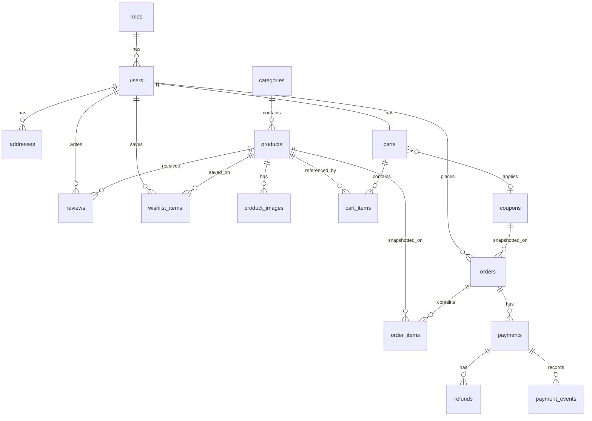

# Database

MySQL 8.x database name: `product_shopping_db`.

The schema is created and changed only through Alembic migrations. The application does not call `create_all` in production and does not rely on hand-edited tables.

Connection settings come from environment variables:

```text
mysql+pymysql://DB_USERNAME:DB_PASSWORD@DB_HOST:DB_PORT/DB_NAME
```

The SQLAlchemy engine uses a connection pool. Sessions are synchronous. Service methods commit on success and roll back on failure.

## Conventions

- Primary keys are `BIGINT` unsigned, named `id`, generated by the database.
- Foreign keys are declared and indexed.
- Timestamps are `created_at` and `updated_at`, stored in UTC as `DATETIME(6)`.
- Money columns are `DECIMAL(12,2)`. Currency is INR.
- Rates such as tax percent and discount percent are `DECIMAL(5,2)`.
- Boolean flags are `TINYINT(1)`.
- Status and type columns are MySQL `ENUM` values matching the application enums.
- Email, SKU, slug, coupon code, and order number columns are case-insensitive unique indexes using a consistent collation (`utf8mb4_0900_ai_ci` for general text, with unique indexes on the natural keys).
- Engine is InnoDB. Character set is `utf8mb4`.

## Entity relationships



Cardinalities in words:

- One role has many users.
- One category has many products.
- One product has many images.
- One user has many addresses.
- One user has one active cart.
- One cart has many cart items, and a product appears at most once on a cart.
- One user has many orders.
- One order has many order items.
- One order has one or more payment attempts.
- One payment has zero or more refunds and zero or more webhook events.
- One user has at most one review per product and at most one wishlist row per product.

## Tables

### roles

| Column | Type | Notes |
| --- | --- | --- |
| id | BIGINT PK | |
| name | VARCHAR(32) UNIQUE | `CUSTOMER`, `ADMIN` |
| created_at | DATETIME(6) | |

Seeded by migration: `CUSTOMER`, `ADMIN`.

### users

| Column | Type | Notes |
| --- | --- | --- |
| id | BIGINT PK | |
| role_id | BIGINT FK → roles.id | Restrict delete |
| email | VARCHAR(255) UNIQUE | Login name |
| password_hash | VARCHAR(255) | Argon2 hash |
| refresh_token_jti | VARCHAR(64) NULL | Current refresh token id; rotated on login and refresh |
| full_name | VARCHAR(120) | |
| phone | VARCHAR(20) NULL | |
| is_active | TINYINT(1) | Default 1 |
| created_at, updated_at | DATETIME(6) | |

Index: `role_id`.

### categories

| Column | Type | Notes |
| --- | --- | --- |
| id | BIGINT PK | |
| name | VARCHAR(120) UNIQUE | |
| slug | VARCHAR(140) UNIQUE | |
| description | TEXT NULL | |
| image_url | VARCHAR(500) NULL | File URL, not the file bytes |
| is_active | TINYINT(1) | Default 1 |
| created_at, updated_at | DATETIME(6) | |

### products

| Column | Type | Notes |
| --- | --- | --- |
| id | BIGINT PK | |
| category_id | BIGINT FK → categories.id | Restrict delete |
| name | VARCHAR(200) | |
| slug | VARCHAR(220) UNIQUE | |
| sku | VARCHAR(64) UNIQUE | |
| brand | VARCHAR(120) | |
| description | TEXT | |
| specifications | JSON | Key-value specification map |
| price | DECIMAL(12,2) | Must be `>= 0` |
| discount_percent | DECIMAL(5,2) | 0 through 100 |
| tax_rate | DECIMAL(5,2) NULL | Null uses the configured default GST rate |
| stock_quantity | INT | Must be `>= 0` |
| is_active | TINYINT(1) | Customers see only active products |
| is_featured | TINYINT(1) | Home page featured rail |
| created_at, updated_at | DATETIME(6) | |

Indexes: `category_id`, `brand`, `price`, `is_active`, `created_at`. A composite index on `(is_active, category_id, price)` supports the public listing query.

Check constraints: `price >= 0`, `discount_percent` between 0 and 100, `stock_quantity >= 0`, and `tax_rate` null or between 0 and 100.

Products that are referenced by order items are deactivated (`is_active = 0`) instead of deleted.

### product_images

| Column | Type | Notes |
| --- | --- | --- |
| id | BIGINT PK | |
| product_id | BIGINT FK → products.id | Cascade delete when the product row itself is removed |
| url | VARCHAR(500) | |
| alt_text | VARCHAR(200) NULL | |
| sort_order | INT | Default 0 |
| is_primary | TINYINT(1) | One primary image per product, enforced in the service layer |
| created_at | DATETIME(6) | |

Index: `(product_id, sort_order)`.

### addresses

| Column | Type | Notes |
| --- | --- | --- |
| id | BIGINT PK | |
| user_id | BIGINT FK → users.id | Cascade delete |
| full_name | VARCHAR(120) | |
| phone | VARCHAR(20) | |
| line1 | VARCHAR(200) | |
| line2 | VARCHAR(200) NULL | |
| city | VARCHAR(80) | |
| state | VARCHAR(80) | |
| postal_code | VARCHAR(12) | |
| country | VARCHAR(80) | Default `India` |
| is_default | TINYINT(1) | At most one default per user, enforced in the service layer |
| created_at, updated_at | DATETIME(6) | |

Index: `user_id`.

### coupons

| Column | Type | Notes |
| --- | --- | --- |
| id | BIGINT PK | |
| code | VARCHAR(40) UNIQUE | Stored uppercase |
| discount_type | ENUM | `PERCENT`, `FIXED` |
| discount_value | DECIMAL(12,2) | Percent points or INR amount |
| min_order_amount | DECIMAL(12,2) | Default 0 |
| max_discount_amount | DECIMAL(12,2) NULL | Cap for percent coupons |
| starts_at | DATETIME(6) NULL | |
| expires_at | DATETIME(6) NULL | |
| usage_limit | INT NULL | Null means unlimited |
| used_count | INT | Default 0 |
| is_active | TINYINT(1) | |
| created_at, updated_at | DATETIME(6) | |

### carts

| Column | Type | Notes |
| --- | --- | --- |
| id | BIGINT PK | |
| user_id | BIGINT UNIQUE FK → users.id | One active cart per user |
| coupon_id | BIGINT NULL FK → coupons.id | Set null if the coupon is removed |
| created_at, updated_at | DATETIME(6) | |

### cart_items

| Column | Type | Notes |
| --- | --- | --- |
| id | BIGINT PK | |
| cart_id | BIGINT FK → carts.id | Cascade delete |
| product_id | BIGINT FK → products.id | Restrict delete |
| quantity | INT | Must be `>= 1` |
| created_at, updated_at | DATETIME(6) | |

Unique: `(cart_id, product_id)`.

Cart rows do not store a price. Totals are calculated from current product data when the cart is read and again at checkout.

### orders

| Column | Type | Notes |
| --- | --- | --- |
| id | BIGINT PK | |
| order_number | VARCHAR(32) UNIQUE | Human-readable invoice reference |
| user_id | BIGINT FK → users.id | Restrict delete |
| status | ENUM | See order statuses below |
| currency | CHAR(3) | `INR` |
| subtotal | DECIMAL(12,2) | Merchandise after product discounts, before coupon |
| product_discount_total | DECIMAL(12,2) | Sum of catalog discounts |
| coupon_code | VARCHAR(40) NULL | Snapshot |
| coupon_discount_total | DECIMAL(12,2) | |
| tax_total | DECIMAL(12,2) | |
| delivery_fee | DECIMAL(12,2) | |
| grand_total | DECIMAL(12,2) | Amount charged |
| contact_name | VARCHAR(120) | Snapshot |
| contact_phone | VARCHAR(20) | Snapshot |
| ship_line1 | VARCHAR(200) | Snapshot |
| ship_line2 | VARCHAR(200) NULL | Snapshot |
| ship_city | VARCHAR(80) | Snapshot |
| ship_state | VARCHAR(80) | Snapshot |
| ship_postal_code | VARCHAR(12) | Snapshot |
| ship_country | VARCHAR(80) | Snapshot |
| stock_reserved_at | DATETIME(6) NULL | |
| reservation_expires_at | DATETIME(6) NULL | |
| stock_released_at | DATETIME(6) NULL | Set when reserved stock is returned |
| created_at, updated_at | DATETIME(6) | |

Indexes: `user_id`, `status`, `created_at`, `reservation_expires_at`.

Address text is copied onto the order so a later address edit does not change the invoice.

### order_items

| Column | Type | Notes |
| --- | --- | --- |
| id | BIGINT PK | |
| order_id | BIGINT FK → orders.id | Cascade delete only if the order row is removed, which normal flows do not do |
| product_id | BIGINT NULL FK → products.id | Set null if a product row is ever removed |
| product_name | VARCHAR(200) | Snapshot |
| sku | VARCHAR(64) | Snapshot |
| unit_price | DECIMAL(12,2) | List price snapshot |
| discount_amount | DECIMAL(12,2) | Per unit |
| tax_rate | DECIMAL(5,2) | |
| tax_amount | DECIMAL(12,2) | For the line |
| quantity | INT | |
| line_total | DECIMAL(12,2) | Quantity times selling price, plus line tax |

Index: `order_id`.

### payments

| Column | Type | Notes |
| --- | --- | --- |
| id | BIGINT PK | |
| order_id | BIGINT FK → orders.id | Restrict delete |
| razorpay_order_id | VARCHAR(64) UNIQUE | |
| razorpay_payment_id | VARCHAR(64) NULL UNIQUE | |
| amount | DECIMAL(12,2) | Must match the order grand total |
| currency | CHAR(3) | `INR` |
| status | ENUM | `CREATED`, `AUTHORIZED`, `CAPTURED`, `FAILED`, `CANCELLED`, `REFUNDED` |
| created_at, updated_at | DATETIME(6) | |

No card number, CVV, or raw secret is stored. Signature values are verified and then discarded rather than kept as a credential.

Index: `order_id`, `status`.

### payment_events

| Column | Type | Notes |
| --- | --- | --- |
| id | BIGINT PK | |
| payment_id | BIGINT NULL FK → payments.id | |
| razorpay_event_id | VARCHAR(64) UNIQUE | Idempotency key |
| event_type | VARCHAR(80) | |
| processed_at | DATETIME(6) | |

A repeated webhook with the same `razorpay_event_id` is acknowledged and not applied again.

### refunds

| Column | Type | Notes |
| --- | --- | --- |
| id | BIGINT PK | |
| payment_id | BIGINT FK → payments.id | |
| razorpay_refund_id | VARCHAR(64) UNIQUE | |
| amount | DECIMAL(12,2) | |
| status | VARCHAR(32) | Gateway refund status |
| reason | VARCHAR(255) NULL | |
| created_at, updated_at | DATETIME(6) | |

### reviews

| Column | Type | Notes |
| --- | --- | --- |
| id | BIGINT PK | |
| user_id | BIGINT FK → users.id | Cascade delete |
| product_id | BIGINT FK → products.id | Cascade delete |
| rating | TINYINT | 1 through 5 |
| title | VARCHAR(160) NULL | |
| body | TEXT | |
| created_at, updated_at | DATETIME(6) | |

Unique: `(user_id, product_id)`.

### wishlist_items

| Column | Type | Notes |
| --- | --- | --- |
| id | BIGINT PK | |
| user_id | BIGINT FK → users.id | Cascade delete |
| product_id | BIGINT FK → products.id | Cascade delete |
| created_at | DATETIME(6) | |

Unique: `(user_id, product_id)`.

## Order statuses

`PENDING_PAYMENT`, `CONFIRMED`, `PROCESSING`, `SHIPPED`, `DELIVERED`, `CANCELLED`, `REFUNDED`.

Allowed transitions are enforced in the order service:

- `PENDING_PAYMENT` → `CONFIRMED`, `CANCELLED`
- `CONFIRMED` → `PROCESSING`, `CANCELLED`, `REFUNDED`
- `PROCESSING` → `SHIPPED`, `CANCELLED`, `REFUNDED`
- `SHIPPED` → `DELIVERED`, `REFUNDED`
- `DELIVERED` → `REFUNDED`
- `CANCELLED` and `REFUNDED` are terminal

## Stock reservation rules

1. Checkout starts a transaction and locks each product row with `SELECT ... FOR UPDATE` in a stable id order.
2. The update decrements `stock_quantity` only when `stock_quantity >= requested quantity` and the product is active.
3. If any line fails that condition, the transaction rolls back and the API returns a conflict.
4. The order stores `stock_reserved_at` and `reservation_expires_at`. The window comes from configuration.
5. On verified capture, status becomes `CONFIRMED`. Stock stays deducted. `stock_released_at` remains null.
6. On payment failure, customer cancellation, or expiry, stock is added back only when `stock_released_at` is null and the order is still `PENDING_PAYMENT`. The same transaction sets `stock_released_at` and `CANCELLED`.
7. A second release attempt sees `stock_released_at` or a non-pending status and does nothing.
8. Expired reservations are released by the same service method, invoked from checkout failure paths and from a maintenance call used by tests and operations. There is no separate inventory ledger in the first release.

## Coupon rules stored in data

A coupon applies only when all of the following are true:

- `is_active` is true
- Current time is inside `starts_at` and `expires_at` when those are set
- Merchandise subtotal is at least `min_order_amount`
- `usage_limit` is null or `used_count` is below it
- The computed discount is greater than zero and not above the remaining merchandise amount

`used_count` increments once, when payment is captured, not when the coupon is typed into the cart.

## Invoice fields

An invoice is rendered from the order and order item snapshots plus the captured payment reference. It includes shop details, invoice number (`order_number`), order id, order date, customer contact, ship-to address, product names, quantities, unit prices, discounts, tax, delivery, grand total, and payment id and status.

## Related documents

- [ARCHITECTURE.md](ARCHITECTURE.md)
- [API.md](API.md)
- [IMPLEMENTATION_PLAN.md](IMPLEMENTATION_PLAN.md)
